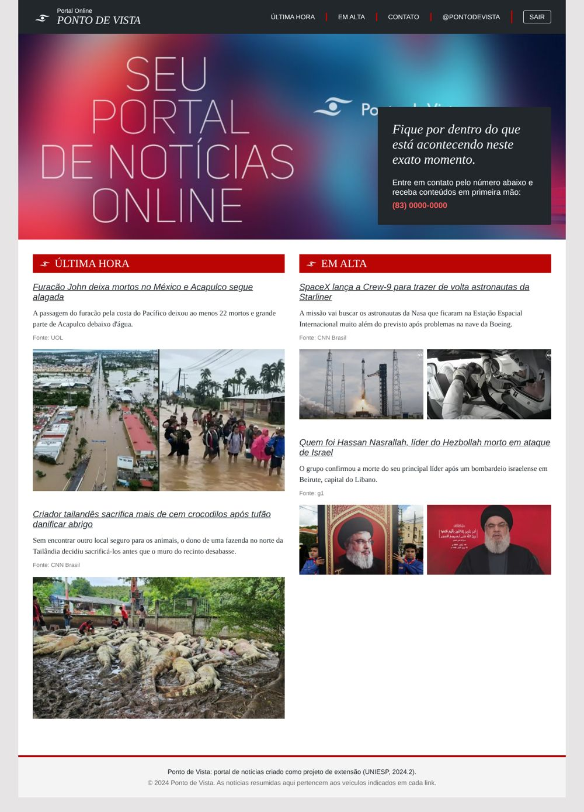

# Ponto de Vista: portal de notícias

Projeto de extensão do curso de **Sistemas para Internet (UNIESP, 2024.2)**: um portal de notícias com **tela de login** e página principal dividida em **Última hora** e **Em alta**, feito com HTML, CSS e JavaScript puro.



- **Documentação do processo:** [Google Docs](https://docs.google.com/document/d/1EvHy_Vzx0HiQxe83soaTwHUh2tae_kTsKPPA2F2LGKA/edit?usp=sharing)
- **Protótipo:** [Figma](https://www.figma.com/design/Nr3Ry5kUB8amXz3Iv4Z7qs/Site?node-id=0-1&node-type=canvas&t=Q1C7HYrlNxyKVmxN-0)

## Funcionalidades

- **Login** com mensagens de erro na própria tela (campos vazios ou senha errada)
- **Página protegida:** quem tenta abrir `portal.html` sem entrar volta para o login
- Botão **Sair**, que encerra a sessão
- **Menu** com rolagem suave até cada seção e versão "hambúrguer" no celular
- **Notícias geradas por JavaScript** a partir de uma lista em `js/noticias.js`
- Layout **responsivo**: duas colunas no computador e uma no celular

## Como usar

Não precisa instalar nada. Abra `site/index.html` no navegador, ou sirva a pasta:

```bash
cd site
python -m http.server 8000   # depois acesse http://localhost:8000
```

**Acesso de demonstração:** usuário `admin`, senha `admin`.

> O login é só demonstrativo: as credenciais ficam no JavaScript do navegador, onde qualquer pessoa consegue lê-las. Num sistema real, a verificação precisa ser feita no servidor, com senha criptografada.

### Publicar uma notícia

Adicione um objeto na categoria desejada em `site/js/noticias.js`:

```js
{
  titulo: "Título da notícia",
  resumo: "Resumo em uma ou duas frases.",
  fonte: "Nome do veículo",
  link: "https://...",
  imagens: [{ src: "img/arquivo.jpg", alt: "Descrição da imagem" }],
}
```

## Estrutura

```
site/
├── index.html        # tela de login
├── portal.html       # portal de notícias
├── css/
│   ├── login.css
│   └── portal.css
├── js/
│   ├── login.js      # validação do login e sessão
│   ├── noticias.js   # conteúdo das notícias
│   └── portal.js     # monta os cards, menu mobile e botão Sair
└── img/
```

## O que mudou em relação à versão entregue

- A pasta foi reorganizada (`css/`, `js/`, `img/`) e os arquivos repetidos (README e LICENSE dentro de subpastas) foram removidos.
- O layout fixo em pixels (ex.: `left: 700px`, `padding-left: 500px`, `height: 1200px` no `body`) foi trocado por **flexbox e grid**, e agora o site funciona no celular.
- Os `alert()` do login viraram mensagens na própria tela, e o portal passou a exigir login.
- As notícias saíram do HTML e passaram a ser geradas a partir de uma lista. Os cards usam `textContent` em vez de `innerHTML`, o que evita injeção de código.
- Os nomes de classes com acento (`.TítuloÚltimaHora`) viraram nomes simples, e o HTML ficou semântico (`nav`, `section`, `article`).
- As imagens foram convertidas para JPG: de 2,5 MB para cerca de 350 KB.
- Os ícones do Font Awesome (CDN em versão beta) foram trocados por SVG embutido.
- Foram adicionados textos alternativos descritivos, foco visível e suporte a "reduzir movimento".

## Equipe

- Elionay da Costa Silva
- Lucas Luna Accioly da Cruz
- Maria Eduarda Maia Santos
- **João Victor Soares de Lima**: [GitHub](https://github.com/JOAOVICTORSOARESDELIMA)

## Licença

Código sob [MIT](LICENSE). As notícias são resumos com link para os veículos originais (UOL, CNN Brasil e g1), e as imagens são usadas apenas para fins acadêmicos.
